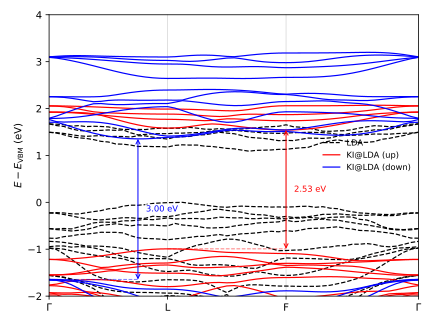

######################################################
 CrI\ :sub:`3`, and a band structure per spin channel
######################################################

In its low-temperature phase, bulk CrI\ :sub:`3` is a ferromagnetic semiconductor: each
of the two Cr atoms in the primitive cell carries three unpaired *d* electrons, all
aligned. This tutorial computes its KI band structure with the screening parameters
taken from linear response in the primitive cell, which is what ``formalism: dfpt``
asks for. What this page is about is the ingredient a magnet adds. The two spin channels
no longer hold the same electrons, so they are Wannierized separately, screened
separately, and come out as two band structures rather than one.

****************
 The input file
****************

Download :download:`cri3.yaml <cri3.yaml>` and place it in an empty directory. Here it
is in full:

.. literalinclude:: cri3.yaml
    :language: yaml

.. warning::

    The cutoff and the k-point grid in this file are deliberately rough, so that the
    workflow finishes in a reasonable time. They are not converged, and neither is the
    band structure that comes out of them. Use this file to learn the input format, not
    as a starting point for production work, and read the numbers below as a
    demonstration rather than as results.

*************************
 Running the calculation
*************************

.. warning::

    Make sure you have installed ``koopmans``: see :doc:`here <../../../installation>`
    for more details.

    This workflow needs ``pw.x``, ``pw2wannier90.x`` and ``kcw.x`` from ``Quantum
    ESPRESSO``, and ``wannier90.x`` alongside them.

Run the calculation with

.. code-block:: console

    $ koopmans run cri3.yaml

The terminal shows a live progress table as the workflow proceeds. It begins with a
shared pair of ``pw.x`` calculations, one SCF and one NSCF, which is the only stage the
two channels have in common, since a single spin-polarized calculation produces both
densities at once. Everything after it comes in twos: a Wannierization of each channel,
block by block, then a ``kcw.x`` chain per channel that converts the Wannier functions
into the form ``kcw.x`` reads, computes that channel's screening parameters, and finally
builds and diagonalizes the Koopmans Hamiltonian along the k-path. The finished table
reads

.. code-block:: text

     Step                                                      Code              Status
     Koopmans DFPT                                                             finished
       Ground state                                                            finished
         SCF                                                   pw.x            finished
         NSCF                                                  pw.x            finished
       Wannierization (spin down)                                              finished
         Band structure                                        pw.x            finished
         Wannierization (empty block 1, spin down)                             finished
           Preprocessing                                       wannier90.x     finished
           Overlaps                                            pw2wannier90.x  finished
           Minimization                                        wannier90.x     finished
         Wannierization (empty block 2, spin down)                             finished
           Preprocessing                                       wannier90.x     finished
           Overlaps                                            pw2wannier90.x  finished
           Minimization                                        wannier90.x     finished
         Wannierization (occupied block 1, spin down)                          finished
           Preprocessing                                       wannier90.x     finished
           Overlaps                                            pw2wannier90.x  finished
           Minimization                                        wannier90.x     finished
         Wannierization (occupied block 2, spin down)                          finished
           Preprocessing                                       wannier90.x     finished
           Overlaps                                            pw2wannier90.x  finished
           Minimization                                        wannier90.x     finished
         Wannierization (occupied block 3, spin down)                          finished
           Preprocessing                                       wannier90.x     finished
           Overlaps                                            pw2wannier90.x  finished
           Minimization                                        wannier90.x     finished
         Wannierization (occupied block 4, spin down)                          finished
           Preprocessing                                       wannier90.x     finished
           Overlaps                                            pw2wannier90.x  finished
           Minimization                                        wannier90.x     finished
         Atomic projections                                    projwfc.x       finished
       Wannierization (spin up)                                                finished
         Band structure                                        pw.x            finished
         Wannierization (empty block, spin up)                                 finished
           Preprocessing                                       wannier90.x     finished
           Overlaps                                            pw2wannier90.x  finished
           Minimization                                        wannier90.x     finished
         Wannierization (occupied block 1, spin up)                            finished
           Preprocessing                                       wannier90.x     finished
           Overlaps                                            pw2wannier90.x  finished
           Minimization                                        wannier90.x     finished
         Wannierization (occupied block 2, spin up)                            finished
           Preprocessing                                       wannier90.x     finished
           Overlaps                                            pw2wannier90.x  finished
           Minimization                                        wannier90.x     finished
         Wannierization (occupied block 3, spin up)                            finished
           Preprocessing                                       wannier90.x     finished
           Overlaps                                            pw2wannier90.x  finished
           Minimization                                        wannier90.x     finished
         Wannierization (occupied block 4, spin up)                            finished
           Preprocessing                                       wannier90.x     finished
           Overlaps                                            pw2wannier90.x  finished
           Minimization                                        wannier90.x     finished
         Atomic projections                                    projwfc.x       finished
       DFPT screening (spin up)                                                finished
         Wannier gauge                                         kcw.x           finished
         Orbital screening                                                     finished
           Orbital 8                                           kcw.x           finished
           Orbital 14                                          kcw.x           finished
           Orbital 31                                          kcw.x           finished
           Orbital 32                                          kcw.x           finished
           Orbital 38                                          kcw.x           finished
           Orbital 39                                          kcw.x           finished
         Koopmans Hamiltonian                                  kcw.x           finished
       DFPT screening (spin down)                                              finished
         Wannier gauge                                         kcw.x           finished
         Orbital screening                                                     finished
           Orbital 8                                           kcw.x           finished
           Orbital 14                                          kcw.x           finished
           Orbital 32                                          kcw.x           finished
           Orbital 33                                          kcw.x           finished
           Orbital 39                                          kcw.x           finished
         Koopmans Hamiltonian                                  kcw.x           finished

    Workflow completed successfully!

Each channel Wannierizes a different number of blocks, five for the up channel and six
for the down one, matching the two projection lists in the input. Each channel's
screening step runs one ``kcw.x`` calculation per *group* of orbitals rather than one per
orbital: six representatives for the up channel's 42 orbitals, five for the down
channel's 42.

*************
 The outputs
*************

The results land in a directory named after the input file, here ``cri3/``, with one
directory per step, numbered in the order the steps were created, laid out as the
:doc:`ozone tutorial <../../orbital_energies/ozone/automatically>` describes:

.. code-block:: text

    cri3
    ├── 01-scf_nscf
    │   ├── 01-scf
    │   ├── 02-nscf
    │   └── outputs
    ├── 02-wannierize_down
    │   ├── 01-bands
    │   ├── 02-wannierize_emp_down_1
    │   ├── 03-wannierize_emp_down_2
    │   ├── 04-wannierize_occ_down_1
    │   ├── 05-wannierize_occ_down_2
    │   ├── 06-wannierize_occ_down_3
    │   ├── 07-wannierize_occ_down_4
    │   ├── 08-projwfc
    │   └── outputs
    ├── 03-wannierize_up
    │   ├── 01-bands
    │   ├── 02-wannierize_emp_up
    │   ├── 03-wannierize_occ_up_1
    │   ├── 04-wannierize_occ_up_2
    │   ├── 05-wannierize_occ_up_3
    │   ├── 06-wannierize_occ_up_4
    │   ├── 07-projwfc
    │   └── outputs
    ├── 04-dfpt_up
    │   ├── 01-prepare_kcw_wannier_files
    │   ├── 02-wann2kc
    │   ├── 03-grouped_screen
    │   ├── 04-ham
    │   └── outputs
    ├── 05-dfpt_down
    │   ├── 01-prepare_kcw_wannier_files
    │   ├── 02-wann2kc
    │   ├── 03-grouped_screen
    │   ├── 04-ham
    │   └── outputs
    └── outputs

What is new compared to the ozone layout is that there are two of nearly everything: a
Wannierization and a ``kcw.x`` chain (``dfpt_up``/``dfpt_down``) for each channel.

Each channel's chain ends in a ``ham`` step, which holds the two results worth reading.
Its ``inputs/file_alpharef.txt`` lists the screening parameters that were used, one line
per variational orbital of that channel. Its ``outputs/aiida.kho`` is the ``kcw.x``
output. Two lines in it report the highest occupied and lowest unoccupied level, one
labelled ``KS``, which is the underlying LDA result, and one labelled ``KI[2nd]``, which
is the Koopmans one; the interpolated eigenvalues along the k-path follow them. Those
two lines are evaluated on the k-point mesh the Wannier functions were built on, so they
differ slightly from the path values quoted below.

**************************
 Interpreting the results
**************************

Two band structures have to be read together. An electron leaving the crystal comes out
of whichever channel holds the highest occupied state, and one arriving goes into
whichever holds the lowest empty state, and those need not be the same channel. Draw
both channels on one set of axes with

.. code-block:: console

    $ koopmans plot bandstructure \
        cri3/04-dfpt_up/04-ham --label "KI@LDA (up)" --style r- --gap \
        cri3/05-dfpt_down/04-ham --label "KI@LDA (down)" --style b- --gap \
        cri3/03-wannierize_up/01-bands --label "LDA (both channels)" --style k-- \
        --ylim -2 6 \
        -o ki_bandstructure.svg

    The KI band structure of each channel (solid), against the LDA reference (dashed
    black, both channels together). Up in red, down in blue; the arrows mark each
    channel's own band gap along the k-path. Energies are relative to the valence band
    maximum of the first series listed, the KI up channel.

All the numbers below are read along this k-path, and the energies of LDA and KI share
one scale.

.. question:: What does the underlying LDA calculation give?

    Gaps of 1.09 eV in the up channel and 1.91 eV in the down one. The valence band
    maximum lies in the up channel (5.30 eV, against 4.52 eV in the down channel). The
    conduction band minimum also lies in the up channel (6.39 eV, on the segment from L to
    F), just below the down channel's (6.43 eV). The fundamental gap is therefore the up
    channel's own, 1.09 eV, and it is not an inter-spin gap.

.. question:: What does KI do to the gap?

    It opens both channels, to 2.53 eV in the up channel and 3.00 eV in the down one, and
    it moves the conduction band minimum from one channel to the other. The valence band
    maximum stays in the up channel (4.31 eV, against 3.66 eV in the down channel). The
    conduction band minimum is now in the down channel (6.66 eV, against 6.85 eV in the
    up channel). The fundamental gap is therefore an inter-spin gap, 2.34 eV, between the
    up valence band and the down conduction band. In going from LDA to KI, the minimum
    passes from the majority channel to the minority one.

.. question:: Why do the two channels' empty states move by different amounts?

    KI raises the up channel's conduction band minimum by 0.45 eV and the down channel's
    by 0.23 eV. The correction an orbital receives grows with its screening parameter,
    and depends on how localized the orbital is, and both differ between the channels.
    The up channel's empty Cr *d* functions have a screening parameter of 0.10 and a
    spread of 4.69 Å\ :sup:`2`. The down channel's lowest empty Cr *d* functions have 0.05
    and 2.89 Å\ :sup:`2`. The screening parameters are computed rather than assumed,
    which is the point of the calculation: the up channel's 42 orbitals group into 6
    distinct values, from 0.10 to 0.21, and the down channel's 42 into 5, from 0.05 to
    0.21.

**************************
 Understanding the input
**************************

---------------
 Spin channels
---------------

.. literalinclude:: cri3.yaml
    :language: yaml
    :start-at: spin: collinear
    :end-at: spin: collinear

is the keyword that makes this a magnetic calculation. ``spin`` takes four values:

``none``
    One density, one set of orbitals, every orbital doubly occupied. This is the
    default, and it is what every non-magnetic tutorial uses.

``collinear``
    Two densities, :math:`n^\uparrow(\mathbf{r})` and :math:`n^\downarrow(\mathbf{r})`,
    free to differ. Every spin points along one axis, up or down, and every orbital
    belongs to one channel or the other.

``non_collinear``
    Spinor wavefunctions, so the magnetization can point in different directions in
    different parts of the cell.

``spin_orbit``
    Spinors again, with spin-orbit coupling switched on.

A ferromagnet is the case ``collinear`` was made for. Every moment is parallel to every
other, so a single axis is enough, but the two channels are genuinely different, here
holding 38 electrons and 32.

For a Koopmans calculation the consequence runs deeper than a second density. Each
variational orbital now carries a spin channel as well as an index, each gets its own
screening parameter, and the correction is applied channel by channel.

.. literalinclude:: cri3.yaml
    :language: yaml
    :start-at: tot_magnetization
    :end-at: tot_magnetization

fixes how the electrons divide between the channels. The pseudopotentials put 70 valence
electrons in the cell, so :math:`N^\uparrow - N^\downarrow = 6` makes it 38 up and 32
down.

.. question:: Where does 6 come from?

    Each Cr atom in CrI\ :sub:`3` is a Cr\ :sup:`3+` ion, a *d*\ :sup:`3` configuration
    whose three *d* electrons are unpaired. Two Cr atoms make six unpaired electrons, and
    in the ferromagnetic state all six point the same way.

    ``tot_magnetization`` constrains the calculation rather than merely starting it off,
    so it has to be the right answer rather than a guess. It is also a *net* moment, and
    a net moment is not the moment on any one atom: at this level of theory the moment
    integrated around each Cr is 2.66 :math:`\mu_B`, and around each of the six I atoms
    it is −0.03 :math:`\mu_B`, so the iodines are polarized slightly the other way.

    Changing ``tot_magnetization`` changes the electron count of each channel, so the
    projection lists below have to change with it.

-------------------------
 Two sets of projections
-------------------------

Wannier functions are built from projections onto trial orbitals, and a block of
projections names a group of bands to be Wannierized together. A magnetic calculation
needs one list per channel, because the channels do not contain the same bands:

.. literalinclude:: cri3.yaml
    :language: yaml
    :start-at: wannier90:

The first four blocks of each list span the occupied manifold and the rest span the
low-lying empty states. Both lists open the same way (Cr *s*, Cr *p*, I *s*) and then
diverge.

.. question:: Why does the fourth block differ between the two channels?

    Because that is where the unpaired electrons are. In the up channel the fourth block
    is I *p* together with three of the five Cr *d* orbitals, which are occupied; the
    other two are empty and form a block of their own. In the down channel the fourth
    block is I *p* alone, and all five *d* orbitals are empty, split across two blocks.

    Counting the Wannier functions checks the arithmetic. The up list has :math:`2 + 6 +
    6 + (18 + 6) = 38` occupied functions and the down list :math:`2 + 6 + 6 + 18 = 32`,
    which is exactly the 38/32 split that ``tot_magnetization: 6`` asks for. A list that
    disagrees passes parsing but is refused when the workflow is built. Replacing the up
    list's fourth block with I *p* alone, for instance, gives

    .. code-block:: text

        OccupiedCoverageError: The occupied projection blocks span 36 Wannier functions but the system has 38 occupied bands.

.. question:: Why is there no disentanglement window here, when the other band-structure tutorials have one?

    Because each block here is an isolated group of bands, separated from its neighbours
    by a gap right across the Brillouin zone. Disentanglement (``dis_win_max``,
    ``dis_froz_max``) is what you reach for when the bands you want are tangled with
    bands you do not, as the empty manifold of a semiconductor usually is. An isolated
    group needs none of it: the Wannier functions span the block exactly, and the
    eigenvalues of the Wannier Hamiltonian reproduce the ones ``pw.x`` computed.

.. question:: How would I choose these blocks for a material of my own?

    From the projected density of states, splitting the manifold wherever the character
    of the bands changes.

.. literalinclude:: cri3.yaml
    :language: yaml
    :start-at: group_orbitals_by
    :end-at: group_orbitals_tol

lets Wannier functions whose spreads agree to within 0.1 Å\ :sup:`2` share a screening
parameter, so that :math:`\alpha` is computed once per group and copied to the rest,
saving a linear-response calculation for each copy. This is an approximation, because
orbitals with similar spreads need not be equivalent. Here it puts the Cr 3\ *s*
functions (spread 0.25 Å\ :sup:`2`) and the Cr 3\ *p* functions (0.30 Å\ :sup:`2`) in
one group, so they share :math:`\alpha`: 0.16 in the up channel and 0.11 in the down one.
A smaller tolerance splits groups like this one, at the cost of more linear-response
calculations. Grouping happens inside a channel: an up orbital never shares a parameter
with a down one.

----------------------
 The rest of the file
----------------------

The remaining settings are the ones any crystal needs. ``atoms`` gives the rhombohedral
cell and the eight atoms in it, and ``kpoints`` gives both the mesh the Wannier
functions are built on and the path

.. literalinclude:: cri3.yaml
    :language: yaml
    :start-at: path:
    :end-at: path:

the final band structure is drawn along. Γ, L and F are labelled points of the
rhombohedral Brillouin zone, and ``koopmans`` resolves them against the lattice the cell
describes.

.. literalinclude:: cri3.yaml
    :language: yaml
    :start-at: formalism
    :end-at: formalism

computes the screening parameters from linear response, in the primitive cell. The
alternative is to compute them from total-energy differences in a supercell, which is
what the :doc:`silicon tutorials <../silicon_finite_differences/index>` compare the two
routes on. Linear response is the practical choice here: a supercell of CrI\ :sub:`3` is
a large object, and ``kcw.x`` interpolates the band structure at the end of the same
run.

.. note::

    One setting this file leaves out is ``eps_inf``, the macroscopic dielectric constant
    that the long-range part of the screening correction uses. For production work on a
    solid you should supply it, either as a number or as ``'auto'``, which computes it
    with ``ph.x`` first. See the :doc:`dielectric constants tutorial
    <../../dielectric_constants/index>`.
