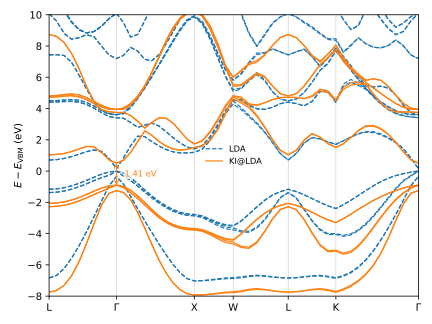
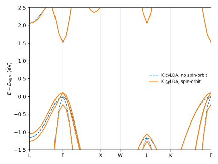

##########################################
 Band structures with spin-orbit coupling
##########################################

This tutorial computes the KI@LDA band structure of bulk gallium arsenide with spin-orbit
coupling. The screening parameters come from linear response, as in the
:doc:`linear-response tutorial <../silicon_linear_response/index>`. Three things differ
from that tutorial:

- Spin-orbit coupling is included, so the calculations run on spinor wavefunctions.
- Spin-orbit coupling has to be built into the pseudopotentials, and no family that
  ``koopmans`` installs automatically has it together with the LDA, so you install one by
  hand first.
- The screening parameters are given in the input file rather than computed, because with
  spinor wavefunctions each linear-response calculation takes about a day on four MPI
  ranks.

******************
 Pseudopotentials
******************

A calculation with spin-orbit coupling needs fully relativistic pseudopotentials.
``kcw.x`` supports only the LDA when spin-orbit coupling is enabled, so the
pseudopotentials must also be LDA. ``koopmans`` installs `PseudoDojo
<http://www.pseudo-dojo.org/>`_'s fully relativistic families automatically for PBE and
PBEsol, but not for LDA, so this family has to be installed by hand.

Thankfully, PseudoDojo publishes fully relativistic LDA pseudopotentials,
and ``aiida-pseudo`` can install any directory of pseudopotentials as a family. First
download gallium and arsenic from PseudoDojo:

.. code-block:: console

    $ mkdir LDA-FR-GaAs
    $ curl -Lo LDA-FR-GaAs/Ga-d_r.upf https://raw.githubusercontent.com/PseudoDojo/ONCVPSP-LDA-FR-PDv0.4/main/Ga/Ga-d_r.upf
    $ curl -Lo LDA-FR-GaAs/As-d_r.upf https://raw.githubusercontent.com/PseudoDojo/ONCVPSP-LDA-FR-PDv0.4/main/As/As-d_r.upf

Then install the directory as a family, as described :ref:`on the installation page
<installation:Pseudopotentials>`:

.. code-block:: console

    $ aiida-pseudo install family LDA-FR-GaAs LDA-FR-GaAs -P pseudo.upf

.. warning::

    The repository's README says this LDA table reuses the generation inputs of the PBE
    table with only the functional changed, and asks that it be used with care. It is
    adequate for a tutorial such as this; check it before using it in production.

****************
 The input file
****************

Download :download:`gaas.yaml <gaas.yaml>` and place it in an empty directory. Here it is in
full:

.. literalinclude:: gaas.yaml
    :language: yaml

Most of it reads like the input for a silicon Koopmans band-structure calculation. The
differences all follow from spin-orbit coupling, which couples an electron's spin to its
orbital motion. Spin up and spin down are then no longer conserved separately, so the
wavefunctions become spinors: two-component objects in which the two mix. This is enabled
with

.. literalinclude:: gaas.yaml
    :language: yaml
    :start-at: spin: spin_orbit
    :end-at: spin: spin_orbit

.. question:: How many filled bands does GaAs have in this calculation?

    For spinor wavefunctions, spin is no longer a label on a band. This means that
    each band holds one electron rather than two.

    The gallium and arsenic pseudopotentials have pseudoatomic charges of 13
    (:math:`3d^{10} 4s^2 4p^1`) and 15 (:math:`3d^{10} 4s^2 4p^3`) respectively, so the cell
    holds 28 valence electrons. Each band holds one electron, so there are 28 filled bands.
    Without spin-orbit coupling we would only have 14.

.. literalinclude:: gaas.yaml
    :language: yaml
    :start-at: pseudo_library
    :end-at: pseudo_library

names the family installed above.

The ``projections`` list four blocks of bands: the arsenic and gallium :math:`3d` shells,
the four valence bands, and the four lowest conduction bands. Each projection now yields
two Wannier functions where it would yield one without spin-orbit coupling, so the four
blocks produce 10, 10, 8 and 8 Wannier functions, 36 in all. The projections and the
disentanglement window themselves are no different from those for a scalar-relativistic
calculation.

.. literalinclude:: gaas.yaml
    :language: yaml
    :start-at: calculate_alpha
    :end-at: calculate_alpha

skips the screening calculations. In their place, the 36 values under ``alpha_guess`` are
used, one per Wannier function, in the order the projection blocks define. These values were
computed by linear response from this same input with ``calculate_alpha: true`` and
``group_orbitals_by: spread``. Under that setting, Wannier functions whose spreads agree
within 0.05 Å\ :sup:`2` share one parameter. Because we don't have two spin channels, there
is one set of screening parameters rather than one per spin channel as in the
:doc:`magnetic solids tutorial <../magnetic/index>`.

*************************
 Running the calculation
*************************

As ever, run the calculation via the command

.. code-block:: console

    $ koopmans run gaas.yaml

The progress table shows a self-consistent calculation, a non-self-consistent one that
adds the empty bands, and one Wannierization per projection block. Then come two kcw.x
steps: one rotates the Hamiltonian into the Wannier gauge, and one builds and
diagonalizes the KI Hamiltonian from the supplied screening parameters. There is no
screening step, because the screening parameters were given.

*************
 The results
*************

Plot the LDA and KI@LDA bands together:

.. code-block:: console

    $ koopmans plot bandstructure \
        gaas/02-wannierize/01-bands --label LDA --style -- \
        gaas/03-dfpt/03-ham --label "KI@LDA" --style - --gap \
        --ylim -8 10 \
        -o gaas_bandstructure.svg

    The KI@LDA band structure of GaAs with spin-orbit coupling, against LDA.

.. question:: How does the KI correction change the band structure?

    It opens the gap. The direct gap at :math:`\Gamma` is 1.41 eV in KI@LDA. Experiment
    gives 1.52 eV :cite:`Marrazzo2024`. In contrast, LDA gives 0.16 eV, so the KI correction
    removes more than ninety percent of LDA's error. The remaining discrepancy is largely
    because we are underconverged: with a denser k-point grid, a higher cutoff and
    pseudopotentials of its own, the KI band gap becomes 1.51 eV :cite:`Marrazzo2024`.

************************************
 The effects of spin-orbit coupling
************************************

To see what spin-orbit coupling does, run the same calculation without it.

.. question:: Create ``gaas-no-soc.yaml`` to run the same calculation but without spin-orbit coupling. What has to change from ``gaas.yaml``?

    Three things:

    - Set ``spin: none``, under which the same pseudopotentials are averaged over
      :math:`j`.
    - Lower ``nbnd`` to 30, since each band again holds two electrons.
    - Replace the 36 screening parameters with 18, which come from a linear-response
      calculation without spin-orbit coupling.

    :download:`gaas-no-soc.yaml <gaas-no-soc.yaml>` has all three changes made.

Run this calculation in the same directory, then plot the
two KI@LDA band structures together:

.. code-block:: console

    $ koopmans run gaas-no-soc.yaml
    $ koopmans plot bandstructure \
        gaas-no-soc/03-dfpt/03-ham --label "KI@LDA, no spin-orbit" --style -- \
        gaas/03-dfpt/03-ham --label "KI@LDA, spin-orbit" --style - \
        --ylim -1.5 2.5 \
        -o soc_comparison.svg

    The KI@LDA band structure of GaAs with and without spin-orbit coupling.

.. question:: How does the spin-orbit coupling change the valence band maximum?

    First, it breaks a degeneracy. Without spin-orbit coupling the three highest valence
    bands are degenerate at :math:`\Gamma`. With it, two of them stay degenerate and the
    third drops below them by the spin-orbit splitting :math:`\Delta_\text{SO}`. These
    bands have standard names: the two that stay degenerate are the so-called heavy-hole
    and light-hole bands, after their curvatures away from :math:`\Gamma`, and the third is
    the split-off band. In the spinor count of the
    spin-orbit calculation, where each band holds one electron, the heavy and light holes
    are bands 25 to 28 and the split-off band is bands 23 and 24. kcw.x prints the KI
    eigenvalues at every k-point of the path in ``gaas/03-dfpt/03-ham/outputs/aiida.kho``;
    at :math:`\Gamma`, bands 17 to 32 read

    .. code-block:: text

        KI     -10.0461   -10.0460   -10.0301   -10.0300    -5.1469    -5.1468     7.4170     7.4171
        KI       7.7639     7.7641     7.7641     7.7643     9.1761     9.1761    12.4146    12.4148

    so the split-off band sits at 7.42 eV and the heavy and light holes at 7.76 eV. Their
    difference, 0.35 eV, is :math:`\Delta_\text{SO}`, and experiment gives 0.35 eV
    :cite:`Marrazzo2024`. The LDA rows in the same block give the same 0.35 eV, so the KI
    correction shifts these bands together and leaves the splitting unchanged.

    Second, it shrinks the gap. The splitting preserves the average energy of the three
    bands: the heavy and light holes rise by :math:`\Delta_\text{SO}/3` and the split-off
    band falls by :math:`2\Delta_\text{SO}/3`. The conduction band minimum, which is built
    from :math:`s` states, does not move. The figure measures energies from the valence
    band maximum of the calculation without spin-orbit coupling, and the valence band
    maximum with it sits 0.12 eV higher while the conduction band minimum is unchanged. So
    the gap closes by :math:`\Delta_\text{SO}/3`: 1.52 eV without spin-orbit coupling,
    against 1.41 eV with it.

*****************
 Optional extras
*****************

To compute the screening parameters yourself, set ``calculate_alpha: true``, remove
``alpha_guess``, and add ``group_orbitals_by: spread`` in either input. The spin-orbit
calculation will not be fast: it involves five linear-response calculations, one per
group of equivalent Wannier functions, each taking about a day on four MPI ranks. Without
spin-orbit coupling each takes a few hours.
