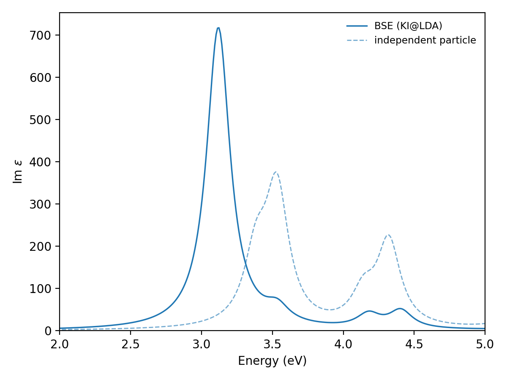

##################################################################
 Optical absorption of silicon, from the Bethe-Salpeter equation
##################################################################

This tutorial computes the optical absorption spectrum of bulk silicon with the
Bethe-Salpeter equation (BSE), on top of quasiparticle energies from a Koopmans
calculation, using `yambo <http://www.yambo-code.org/>`_. It assumes you already know
how a periodic Koopmans calculation is built from Wannier functions, taught in the
:doc:`finite-differences tutorial <../../band_structures/silicon_finite_differences/index>`.

***************
 Prerequisites
***************

Have ``p2y`` and ``yambo`` on your ``PATH`` when you run ``koopmans install``, as
described on the :doc:`installation page <../../../installation>`.

****************
 The input file
****************

Download :download:`si-bse.yaml <si-bse.yaml>` and place it in an empty directory. Here
it is in full:

.. literalinclude:: si-bse.yaml
    :language: yaml

Compared with the finite-differences tutorial's ``si.yaml``, the atoms, the k-point grid,
the cutoff, ``nbnd`` and the Wannier projections are the same. This input changes four
things:

- ``workflow.task`` is ``bse``.
- ``workflow.screening_method`` is ``dfpt``, so the screening parameters come from
  density-functional perturbation theory in the primitive cell instead of total-energy
  differences in a supercell. The ``alpha_guess``, ``alpha_numsteps`` and
  ``group_orbitals_tol`` keywords of the total-energy route are dropped.
- ``kpoints.path`` and ``kpoints.smooth_interpolation_factor`` are dropped, since a
  spectrum has no band path.
- A ``calculator_parameters.yambo`` block and a ``parallelization`` block are added.

The ``yambo`` block sets yambo's own runcard variables under their own names. Six have
no default:

.. literalinclude:: si-bse.yaml
    :language: yaml
    :start-at: yambo:
    :end-before: parallelization:

- ``BndsRnXs`` is the band range that builds the screened Coulomb interaction. This is a
  convergence parameter: raise it until the spectrum stops changing.
- ``NGsBlkXs`` is the G-vector cutoff of that interaction, in Ry. This is also a
  convergence parameter.
- ``BSEBands`` is the band range of the two-particle kernel. It must lie inside the
  Wannierized manifold, since a Koopmans correction exists only for those bands. ``[1, 8]``
  is the whole manifold, four filled and four empty bands.
- ``BEnRange`` is the energy window of the spectrum, in eV.
- ``LongDrXs`` is the light polarization used for the screening.
- ``BLongDir`` is the light polarization used for the spectrum.

``BEnSteps`` sets the number of energy points in the window and ``BDmRange`` the
broadening that turns discrete transitions into a smooth curve, in eV. Both have
defaults, as do the other yambo variables listed in the :doc:`input file documentation
<../../../input_schema>`, under :class:`~koopmans.input_file.YamboBseParameters`.

The ``parallelization`` block gives yambo 4 MPI ranks, which koopmans places on the
electron-hole pairs of the Bethe-Salpeter kernel.

*************
 Running it
*************

.. code-block:: console

    $ koopmans run si-bse.yaml

The progress table walks through the density-functional perturbation theory chain —
scf, nscf, a Wannierization per manifold, then wann2kc, screen and ham — followed by a
fresh yambo chain: an scf and nscf for yambo's own ground state, ``p2y`` to build its
SAVE directory, a step that turns the kcw.x eigenvalues of the ``ham`` step into yambo's
own quasiparticle database, and finally the BSE calculation itself. The
:doc:`linear-response tutorial <../../band_structures/silicon_linear_response/index>`
covers the first part.

.. question:: Which step brings the Koopmans correction into the yambo calculation?

    The step named "Quasiparticle database". It writes the ``ham`` step's Koopmans
    eigenvalues into a yambo ``ndb.QP`` database, in place of the GW database a BSE
    calculation more commonly reads. The BSE step reads that database, so the Koopmans
    eigenvalues set its transition energies and therefore the spectra. The static
    screening is built earlier on the LDA energies, and the database covers bands 1 to 8
    only while ``BndsRnXs`` runs to band 100.

*******************************
 The quasiparticle correction
*******************************

yambo's report on the BSE step states the gap before and after applying that database.
On the :math:`2\times2\times2` grid the indirect gap is 0.62 eV in LDA and 1.39 eV in
KI@LDA, a correction of 0.77 eV.

.. question:: What is the smallest *direct* transition, and where does it sit?

    3.38 eV, at :math:`\Gamma`. This calculation leaves out phonons, so absorption across
    the indirect gap, which needs a phonon to supply the missing momentum, is absent. The
    computed absorption therefore sets in at the lowest direct transition.

**********************
 The optical spectrum
**********************

.. code-block:: console

    $ koopmans plot spectrum si-bse --label "BSE (KI@LDA)" --xlim 2 6 -o spectrum.png

This draws the imaginary part of the dielectric function against energy. The solid curve
is the BSE spectrum. The dashed curve is the independent-particle spectrum, in which each
filled-to-empty transition absorbs on its own, computed from the same KI@LDA energies:

.. question:: What does the electron-hole interaction do to the spectrum?

    It moves the main peak from 3.52 eV in the independent-particle spectrum down to
    3.12 eV and raises its height by a factor of 1.91. Both curves use the same KI@LDA
    energies, so this shift and this gain are the effect of the BSE kernel,
    :math:`2\bar{v} - W` :cite:`Onida2002`, alone. The kernel adds two terms to the
    independent-particle picture. :math:`W` is the screened attraction between the
    electron and the hole, so it lowers the energy of a pair and therefore shifts the
    peak down. :math:`\bar{v}` is the repulsive exchange, or local-field, term, and it
    mixes transitions close in energy so that some gain and some lose oscillator strength.

.. question:: What is the exciton's binding energy?

    The lowest direct transition lies at 3.384599 eV, from the yambo report. The lowest
    exciton lies at 3.118571 eV, from the excitonic states in yambo's BSE database as the
    aiida-yambo parser reads them. The two differ by 3.384599 - 3.118571 = 0.27 eV, so the
    lowest exciton lies 0.27 eV below the lowest direct transition. The
    :math:`2\times2\times2` grid samples the pair's relative motion too coarsely to
    converge this value.

*********
 Up next
*********

To converge the spectrum, raise ``BndsRnXs``, ``NGsBlkXs`` and ``kpoints.grid`` in
``si-bse.yaml`` and rerun until the main peak stops moving.
